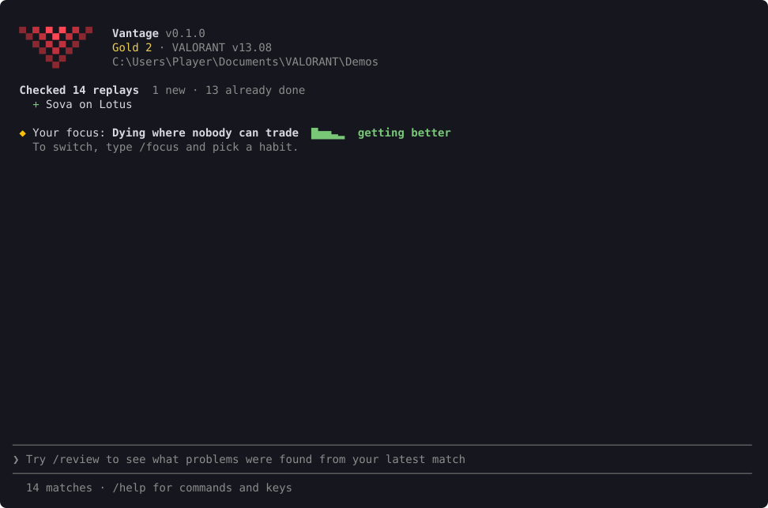
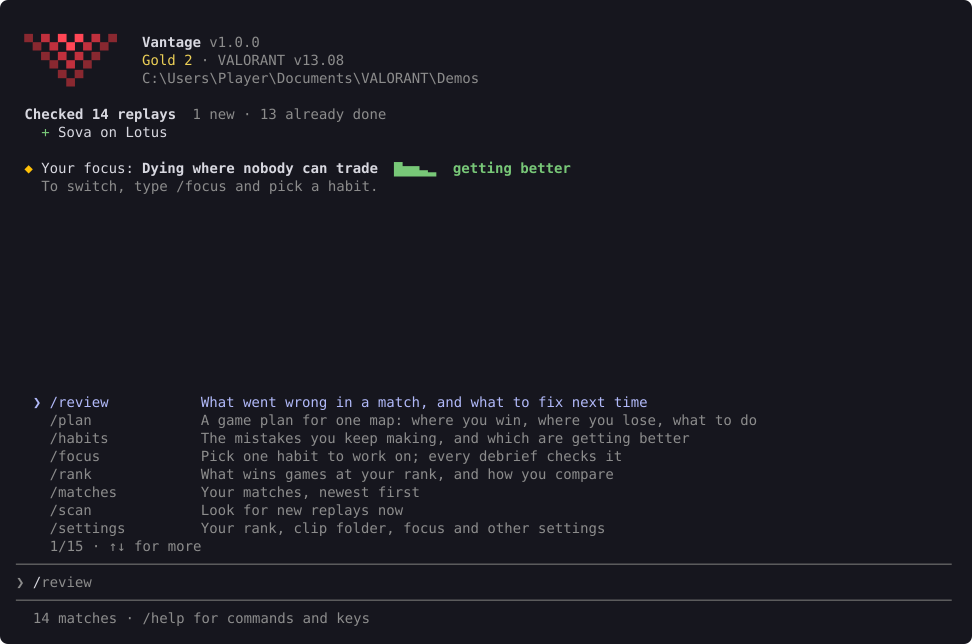

# Commands

Run `vantage` in a terminal to open the shell. When it opens, it reads any new replays and works out which account is yours. While it's open, it picks up each replay you download.



Type `/` to see the commands. Keep typing to filter them, and press Tab to complete one.



| Command | What it does |
| --- | --- |
| `/review` | What went wrong in a match, and what to fix next time. See [Reviewing a match](review.md). |
| `/habits` | The mistakes you keep making, and which are getting better. See [Habits and focus](habits.md). |
| `/focus` | Pick one habit to work on. |
| `/plan` | A game plan for one map. See [Map plans and your rank](plan-and-rank.md). |
| `/rank` | What wins games at your rank, and how you compare. |
| `/matches` | Your matches, newest first. Add `--all` for more than 10. |
| `/scan` | Look for new replays now. Add `--retry-failed` to try failed replays again. |
| `/settings` | Your rank, folders, AI review and other settings. See [Settings and updates](settings.md). |
| `/logs` | Open the folder of session logs, to attach one to a bug report. |
| `/update` | Install the newest Vantage now. |
| `/help` | The commands and keys. |
| `/clear` | Clear the screen. |
| `/exit` | Quit Vantage. |

Add `--help` to a command to see all its options, for example `/scan --help`.

## Keys

| Key | What it does |
| --- | --- |
| Enter | Run the line, or the highlighted command |
| Tab or → | Complete the highlighted suggestion |
| ↑ ↓ | Move in the menu, or go back through what you typed |
| Esc | Hide the menu, or close a panel |
| PgUp PgDn | Scroll the output |
| Ctrl+L | Clear the screen |
| Ctrl+C | Clear the line. Press it twice on an empty line to quit. |

## Outside the shell

Every command also works straight from the terminal, without the `/`. For example:

```powershell
vantage review
vantage plan --map Lotus
vantage matches --all
```

`vantage review` and `vantage plan` print as text, so you can save or share them.
