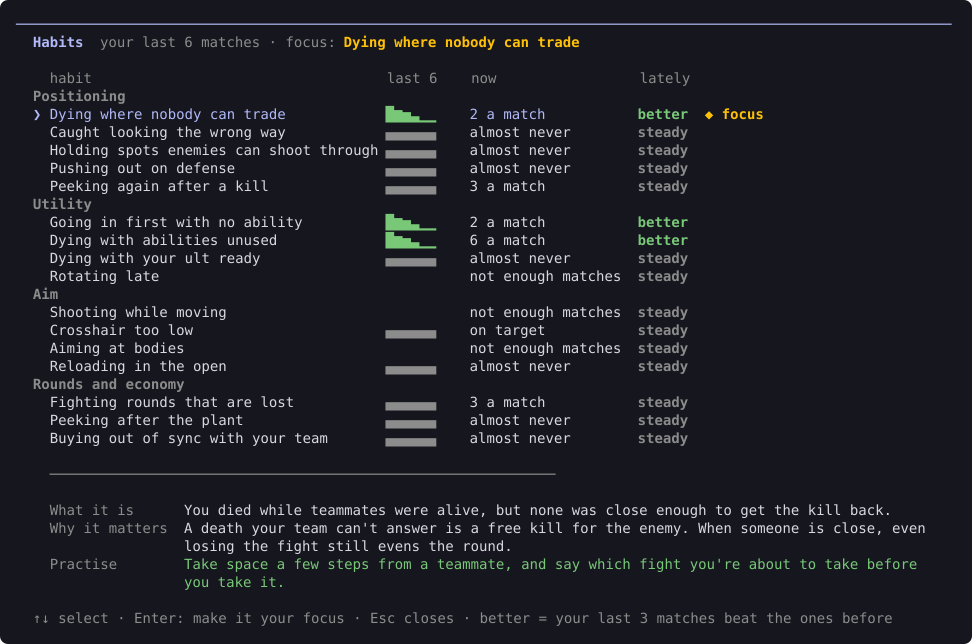

# Habits and focus

Type `/habits` to see the mistakes you keep making, and whether each one is getting better.

Vantage counts 21 habits in every match, over your last 8 matches. A habit is **getting better** when your last 3 matches beat the ones before.

Use ↑ and ↓ to pick a habit and read what it is, why it matters and how to practise it.

## The 21 habits

**Positioning**

- Dying where nobody can trade
- Caught looking the wrong way
- Holding spots enemies can shoot through
- Pushing out on defense
- Peeking again after a kill
- Dying in the same spot again

**Utility**

- Going in first with no ability
- Dying with abilities unused
- Dying with your ult ready
- Rotating late

**Aim**

- Shooting while moving
- Crosshair too low
- Aiming at bodies
- Reloading in the open
- Dying without landing a shot
- Losing fights you'd already won
- Caught with your knife out

**Rounds and economy**

- Fighting several at once in a clutch
- Peeking after the plant
- Dying with the spike
- Buying out of sync with your team

## Your focus

Pick one habit to work on. Every debrief then shows how you did on it, with its trend.

- In `/habits`, pick a habit and press Enter.
- Or type `/focus` and choose one from the list, for example `/focus untraded`.
- Type `/focus` on its own to see your current focus.

Until you pick one, your focus is "Dying where nobody can trade".
