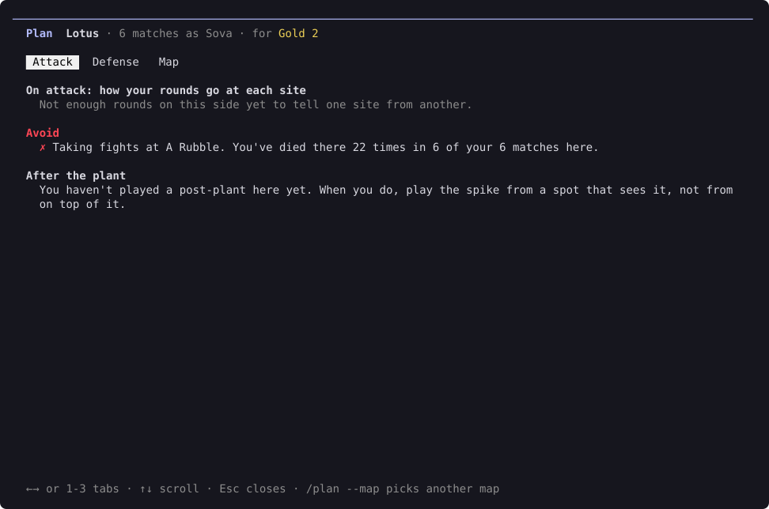
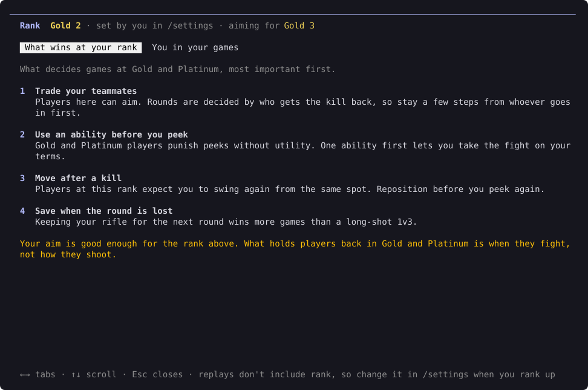

# Map plans and your rank

## Map plans

Type `/plan` before you queue. It gives you a game plan for one map from your own matches: where you win, where you lose, and what to do on each side.

It picks the map you play most. To choose another, type `/plan --map` and pick it from the list, for example `/plan --map Lotus`.

The plan has three tabs: **Attack**, **Defense** and **Map**. It needs 3 matches on the map. With fewer, there are no tabs: you get the map's general tips, what wins at your rank if you've set it, and the top fix from your latest match there.

## Your rank

Type `/rank` to see what wins games at your rank, and how you compare with the players in your games.

Replays don't include your rank, so set it in `/settings` first.

It has two tabs:

- **What wins at your rank**: what matters most at your level, and what to reach the next rank.
- **You in your games**: where you're ahead of the other players in your matches, and where you're behind.
