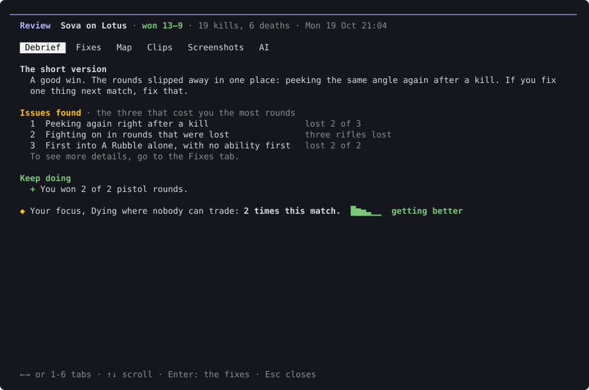
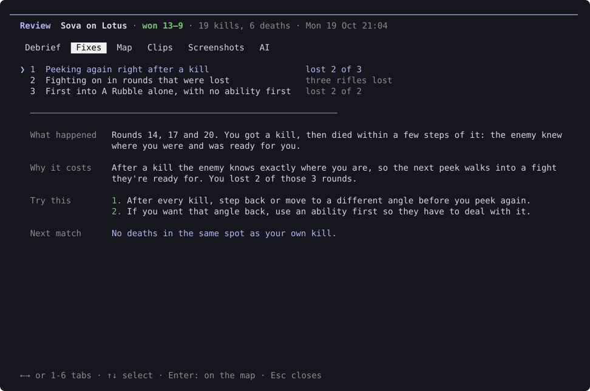
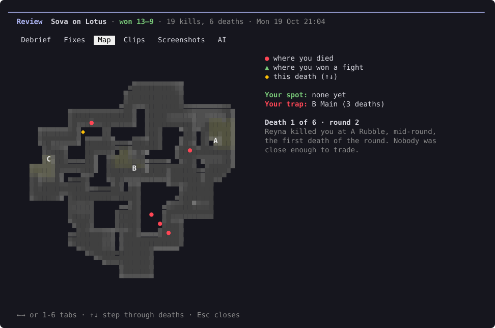
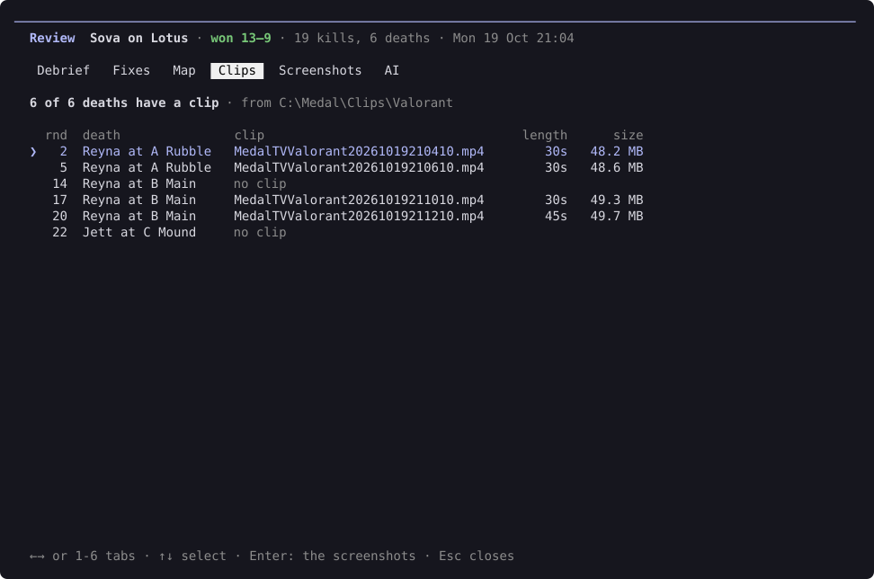
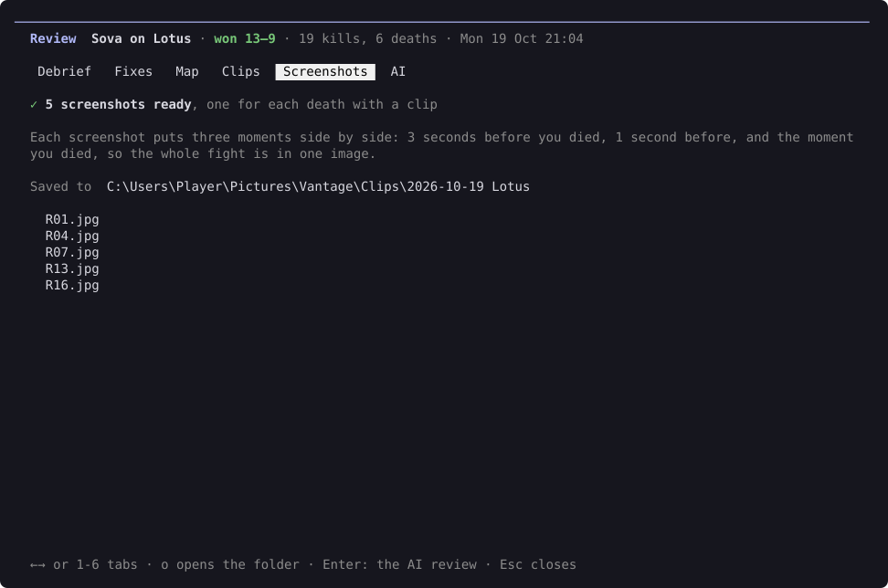
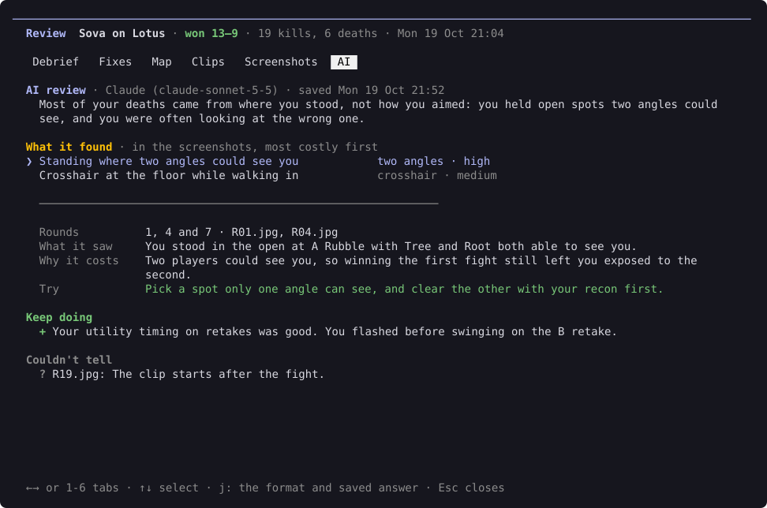

# Reviewing a match

Type `/review` to open the debrief for your newest match. To pick another one, type `/review --match` and choose it from the list.

The review has six tabs. Move between them with ← and →, or press 1 to 6. Esc closes it.

The pictures on this page are drawn by Vantage itself, using made-up matches.

## Debrief

The short version of the match: how it went, the issues that cost you the most rounds, what to keep doing, and how you did on your [focus habit](habits.md#your-focus).

Press Enter to go to the Fixes tab.

## Fixes

Each issue in full: what happened, why it costs you, what to try instead, and what to check next match. Use ↑ and ↓ to pick an issue, and press Enter to see its first death on the map.

## Map

The minimap, drawn in the terminal, with your deaths and your best and worst spots. It's turned so the attackers start at the bottom, the way you see the map on attack. Use ↑ and ↓ to step through your deaths.

## Clips

Your clips matched to your deaths, with each clip's length and size. Medal's clips are matched using Medal's own records of which match and moment each clip is from, so it doesn't matter that Medal saves them all when the match ends. Other apps' clips count when the app saved them within 90 seconds of the death.

The first time, Vantage looks for Medal's clips in `C:\Medal\Clips\Valorant`, where Medal saves them unless you moved its capture folder, and lets you pick it.

If you moved it, or use another clip app, pick **Another folder…**: it points you to `/settings` → Config → **Clip folder**, where you type the path. Change it there later too.

## Screenshots

A screenshot of the seconds before each death, taken from its clip. They're saved in `Pictures\Vantage\Clips`. Press `o` to open the folder.

Screenshots need ffmpeg. The installer gets it for you. If it's missing, the bottom of the screen says so, and `/update` installs it.

## AI

Optional. An AI looks at the screenshots for things the replay can't show, like where you stood and where your crosshair was.

You can use:

- Your AI app, like Claude Desktop or Claude Code, with no API key. It uses the plan you already pay for.
- Claude, ChatGPT or Gemini, with your own API key
- Ollama, which runs on your PC and sends nothing anywhere

Pick the AI and its model in `/settings`. Then press **Ctrl+Enter** on this tab to run the review. Each match is reviewed once, and the answer is saved.

### With your AI app

Pick **Your AI app** in `/settings` → Config → AI review, then the app:

- **Claude Desktop**: Vantage adds itself to Claude Desktop's MCP servers. Restart Claude Desktop afterwards.
- **Claude Code**: Vantage runs `claude mcp add` for you, so it works in every project.
- **Another app**: add a local MCP server to it with the command `vantage mcp`. Any app that runs MCP servers on your PC works, like Cursor, VS Code, LM Studio or Gemini CLI. ChatGPT's app only connects to MCP servers on the internet, so it needs an API key instead.

You start the review from the app's chat, not from Vantage. The AI tab shows what to ask, and **c** copies it, for example:

> Review my VALORANT match Sova on Lotus, Mon 19 Oct 21:04 (match 3f2a9c1b) with Vantage.

The app fetches the match's facts and screenshots from Vantage, and saves its review back in the same format as any other. While it works, the bottom of the screen says so. When it's saved, Vantage says so and the AI tab shows it. Each match is still reviewed once.

[What gets sent to the AI](privacy.md#ai-review)
