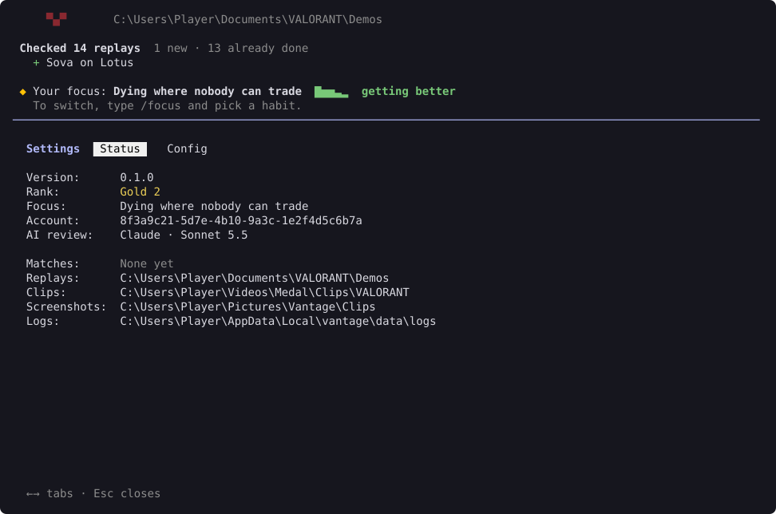
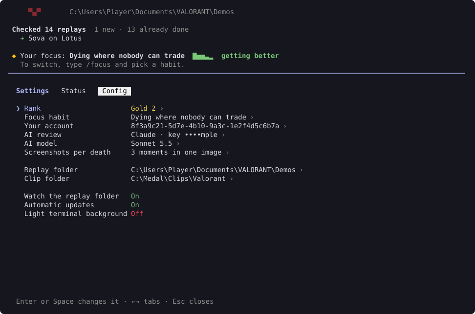
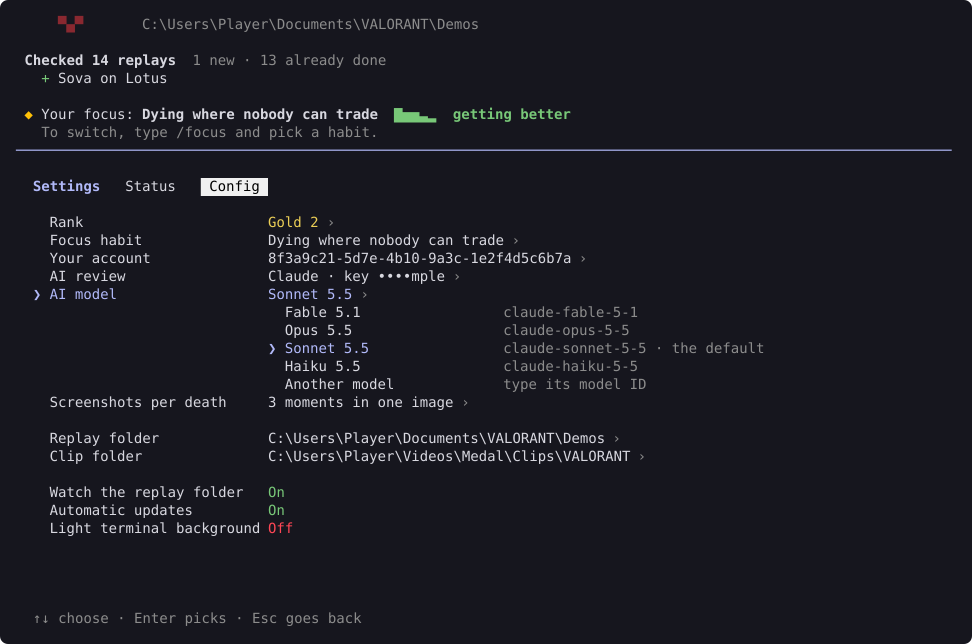

# Settings and updates

Type `/settings` to see how Vantage is set up and to change it. Use ← and → to switch between the two tabs.

## Status

Your version, rank, focus, account and AI review, how many matches are stored, and where your replays, clips, screenshots and logs are.

## Config

Use ↑ and ↓ to pick a setting, and Enter or Space to change it.

| Setting | What it's for |
| --- | --- |
| Rank | Your current rank. Replays don't include it, and `/rank` and `/plan` need it. |
| Focus habit | The habit every debrief checks. See [Your focus](habits.md#your-focus). |
| Your account | Which account is yours. Vantage works this out from your replays; change it if it picked the wrong one. |
| AI review | The AI that reviews your screenshots: Claude, ChatGPT, Gemini or Ollama. It asks for your API key when it needs one. |
| AI model | Which of that AI's models to use. Shown once you pick an AI. |
| Screenshots per death | Three moments in one image (the default), one image of the moment you died, or three separate images. |
| Replay folder | Where VALORANT saves your replays. Vantage finds it for you. |
| Clip folder | Where your clip app saves clips. |
| Watch the replay folder | Pick up new replays while Vantage is open. |
| Automatic updates | Download new versions in the background. |

### Choosing an AI model

Vantage asks the AI for its list of models, so new ones show up without a Vantage update. For Ollama, it lists the models on your PC that can read images. Pick **Another model** to type a model's name yourself.

## Updates

Vantage updates itself. Each time you open it, and every few hours while it's open, it checks for a new version and installs it in the background. The bottom of the screen says "Update available! Restart to apply" when it's ready, and the next launch uses it. The first launch after an update shows what's new.

vrfkit, which reads your replays, updates the same way but needs no restart. When a new VALORANT patch comes out, a vrfkit that reads it usually follows within days. Vantage installs it, says what's new, and reads any replays the old one couldn't.

- To update straight away, type `/update`.
- To stop updating in the background, turn off **Automatic updates** in `/settings`. You can also set the environment variable `VANTAGE_DISABLE_AUTOUPDATER=1`. `/update` still works either way.

## Where settings are kept

Your settings are saved in `config.toml`, in `%LOCALAPPDATA%\vantage\data`. See [Your data](privacy.md).
